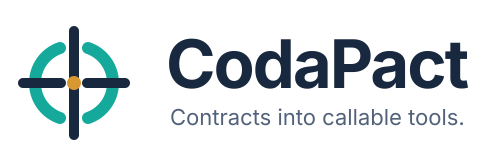

# CodaPact



**Contracts into callable tools.** Generate an installable, typed Python library
and scriptable CLI from a local or remote OpenAPI contract.

## Try it from source

Prerequisites: Git and [uv](https://docs.astral.sh/uv/getting-started/installation/).
uv manages the pinned Python version and dependencies.

```console
git clone https://github.com/mikejhill/codapact.git
cd codapact
uv sync --locked
uv run codapact generate examples/quickstart/openapi.yaml --output .tmp/quickstart --package demo_pets --slug demo-pets --runtime-allow-private
uv run --with . --with ./.tmp/quickstart demo-pets --help
```

Follow [getting started](docs/guides/getting-started.md) to call the included local
server and receive `{"id": 7, "name": "Miso"}`. The demo requires no API account.
For a published installation, use `uv tool install codapact`.

## Configure and extend

- [Documentation](docs/README.md): reading order and area indexes.
- [Configuration](docs/reference/configuration.md): reusable manifests, flags,
  XDG defaults, and separate authentication storage.
- [Endpoint selection](docs/guides/endpoint-selection.md): narrow the library and CLI
  together; inspect changes with `--dry-run`.
- [Supported features](docs/reference/supported-features.md): exact OpenAPI subset
  and safety boundaries.
- [Architecture](docs/architecture/README.md): pluggable translation, selection,
  generation, transport, authentication, and policy interfaces.
- [Contributing](CONTRIBUTING.md): run `uv run poe check` before delivery.

Generated commands discover `config.json` and `auth.json` in
`$XDG_CONFIG_HOME/<slug>` or `~/.config/<slug>`. Override with `--config-dir PATH`.
Programmatic clients use explicit settings and do not read ambient files.

Generated packages pin the CodaPact runtime to the generator version. Source
checkout examples use the local matching runtime; published generated packages
install the matching release automatically.
