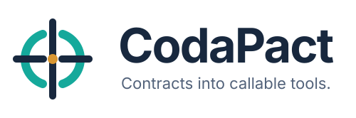

# CodaPact



**Contracts into callable tools.** Read an API contract (OpenAPI 3.0/3.1 or GraphQL),
generate a typed library, then generate a CLI on top of that library.

```text
contract ──► sources ──► semantic model ──► shaping ──► library surface ──► command model
 (OpenAPI,     (L1)          (L2)            (L3)          (L4)              (L5)
  GraphQL)                                                   │                 │
                                                             ▼                 ▼
                                                   library targets      CLI targets
                                                   (Python, TS, plugin) (Python CLI)
```

## Try it

Prerequisites: Git and [uv](https://docs.astral.sh/uv/getting-started/installation/).

```console
git clone https://github.com/mikejhill/codapact.git
cd codapact
uv sync --locked
uv run codapact generate -c examples/petstore/codapact.yaml
uv run --with . --with ./examples/petstore/generated/python petstore pets list --help
```

Quick mode, no project file:

```console
uv run codapact generate --source openapi.yaml --target python --target python-cli \
  --package acme --program acme --out out/
```

Inspect any intermediate layer as JSON:

```console
uv run codapact inspect model   -c examples/library/codapact.yaml
uv run codapact inspect surface -c examples/library/codapact.yaml
uv run codapact inspect commands -c examples/library/codapact.yaml
```

## What you get

| Output | Contents |
| --- | --- |
| `python` | Installable package: `TypedDict` types, a resource-per-namespace client, paging iterators, `py.typed` |
| `python-cli` | argparse CLI calling the Python library: `--help` with examples, `--version`, `describe` (JSON catalog for agents), `doctor`, shell `completion`, `--dry-run`, JSON/JSONL/YAML/table output, JSON errors, documented exit codes; env + XDG settings |
| `typescript` | Fetch-based client with bundled runtime; strict `tsc` clean |
| external plugin | Any executable speaking the JSON plugin protocol |

Generated code is a thin facade over `codapact.runtime`: retries, auth, validation, and
pagination live in one tested place and improve without regenerating.

## Documents

- [Architecture](docs/architecture.md): layers, dependency rules, extension seams, and
  lessons taken from Smithy, Fern, Kiota, protoc, Stainless, Speakeasy, graphql-codegen,
  and restish.
- [Configuration](docs/configuration.md): `codapact.yaml`, shaping transforms, target
  options, and generated CLI settings.
- [Contributing](CONTRIBUTING.md)
