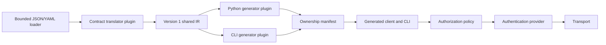

# Architecture

Python 3.13 is the initial implementation and generated language. It fits the
existing uv-based release process and supports typed dictionaries without a
large code generation framework. Runtime schemas validate data independently
of static annotations. TypeScript remains a future target.

## Layer contracts

| Layer | Initial implementation | Extension boundary |
| --- | --- | --- |
| Loading | Bounded JSON/YAML; local files and HTTP(S) | Explicit transport injection |
| Translation | OpenAPI 3.0 JSON HTTP subset | `Translator.translate(document) -> Contract` |
| Shared model | Frozen contract and operation records; schema dictionaries | IR major version, metadata, capability identifiers |
| Library generation | Typed dictionaries, typed methods, JSON IR resource | `Generator.generate(contract, package) -> files` |
| CLI generation | Version 1 definition, argparse commands | Independent generator and CLI runtime |
| Execution | Schema validation and JSON serialization | Generated client inherits `ClientBase` |
| Authentication | Environment-backed bearer, basic, header API key | `AuthProvider.headers(name, scheme)` |
| Policy | Operation allow/deny lists | `AuthorizationPolicy.authorize(operation)` |
| Transport | Pinned DNS, bounded HTTP, verified TLS | `Transport.send(...) -> Response` |
| Orchestration | Explicit registry, capability negotiation, ownership checks | Registry supplied to `generate` |

Plugin API version 1 and IR version 1 are separate contracts. Registration rejects
duplicate names and incompatible API versions. Targets declare required
capabilities; translators declare capabilities they can produce. Plugins are
trusted Python objects registered by the host application, never imported from
contract or configuration strings. A fixture translator and operation-index
generator exercise a complete alternate plugin path in tests.

The normalized IR records operations, parameter schemas, JSON request bodies,
successful and error response schemas, named component types, security OR/AND
requirements, and extensible metadata. OAuth2, GraphQL, Turbo-Stream, gRPC,
streaming transports, other languages, and other CLI styles are future plugins.
They are not implemented or advertised as supported.

## Custom runtime hooks

Pass `auth=`, `policy=`, and `transport=` objects to a generated `Client`. Hooks
are explicit application code. An auth provider returns headers or raises
`AuthError` when credentials are unavailable. A policy raises `PolicyError`
before credentials are resolved and before network activity. Transport plugins
must preserve redirect, credential, timeout, and response-size guarantees.

The generated CLI uses the declarative built-in hooks. Applications needing
custom hooks can call `run_cli` with their own client factory. No configuration
option dynamically imports code or executes shell commands.

## Regeneration

Generators return relative paths and Unicode file contents. The writer checks
all planned writes and removals before mutation, verifies SHA-256 ownership,
refuses modified/unowned files, rejects traversal and symlinks/junctions, and
preserves unrelated files. Obsolete owned files are removed. The manifest is
deterministic and written last; each file replacement is atomic.

A multi-file update is not an atomic filesystem transaction. If interrupted,
the next run fails closed on mismatched ownership. Preserve edited files and
generate into a new directory to recover. Concurrent generation into the same
directory is unsupported. Local plugins and users able to race filesystem
mutations are trusted; this is not an operating-system sandbox.

Authentication and policy contracts live in `auth.py`; data-only JSON/runtime
validation lives in `validation.py`. Neither depends on execution or filesystem
credential discovery. `profiles.py` composes these services without importing
`runtime.py`; the execution layer can therefore validate profiles without an
import cycle. Existing runtime imports of the auth/policy/validation services
remain available for compatibility. Protocol methods are explicit abstract
contracts; incomplete nominal implementations cannot silently satisfy them.
