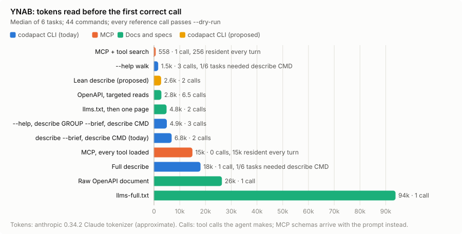

# How efficiently an agent learns a generated CLI

An agent that has never seen an API has to read something before it can make its first
correct call. This report measures how much it reads, and how many tool calls it spends,
for the discovery flow every codapact CLI ships and for the alternatives an agent would
otherwise use: `--help`, the full `describe`, MCP tool schemas, the raw OpenAPI document,
and llms.txt-style docs.

Everything here is regenerated by two scripts in
[`scripts/discovery_bench/`](../../scripts/discovery_bench/); see [Methodology](#methodology).

Measured 2026-11-17 on `main` at 1b80666, which includes every change in
[What changed](#what-changed) ([#61](https://github.com/mikejhill/codapact/pull/61), [#62](https://github.com/mikejhill/codapact/pull/62)), with codapact 0.9.1's behavior simulated from the
same output as the baseline.

## Summary

| | |
| --- | --- |
| **The codapact flow** (`describe --brief`, then `describe COMMAND`) | **2.7k tokens, 2 calls** on YNAB, down from 6.8k in 0.9.1. Always enough for a correct first call, including JSON request bodies. 5× cheaper than full `describe`, 10× cheaper than the OpenAPI document, and under a fifth of the 15k that MCP puts in context on every turn. |
| **Large APIs** | On GitHub REST (1,279 commands) the flow now costs **5.2k tokens in 3 calls**, down from 87k: `describe --brief` lists groups once a CLI has more than 150 commands. |
| **Over a session** | Ten distinct YNAB commands cost **4.9k tokens** in context, down from 23.6k. 0.9.1 overtook loading every MCP tool at six commands; the flow now stays at about a third of it. |
| **Cheapest in tokens** | MCP with client-side tool search (0.6k) and the `--help` walk (1.5k). Tool search needs client support and keeps every tool name resident (14k on GitHub). `--help` costs 3 calls and has no JSON Schemas; it now names each JSON argument's fields. |
| **Worst** | Loading every MCP tool (15k on YNAB, 514k on GitHub, on every turn), the full OpenAPI document (26k, 2.9M), and llms-full.txt (94k, 5.1M). |

## What changed

The first version of this report (0.9.1) found three fixes worth making, and a follow-up
compacted command output too. All are merged into
the runtime and generator now, so every coda gets them when it is regenerated.

| Finding in 0.9.1 | Change | Effect | PR |
| --- | --- | --- | --- |
| 86% of `describe COMMAND` was the output JSON Schema, which the agent needs only after the call | `describe COMMAND` returns arguments and JSON argument schemas; `--schemas` adds the output schema | YNAB median entry: 2.0k → 0.2k tokens | [#61](https://github.com/mikejhill/codapact/pull/61) |
| JSON was indented | `describe` prints compact JSON when stdout is not a terminal | about a third fewer tokens in every `describe` output | [#61](https://github.com/mikejhill/codapact/pull/61) |
| `describe --brief` listed every command (87k tokens on GitHub REST) | Past 150 commands it lists groups (name, summary, count); `start` tells the agent to run `describe GROUP --brief` | GitHub REST catalog: 86k → 2.3k tokens, plus one call for a group | [#61](https://github.com/mikejhill/codapact/pull/61) |
| Command output was indented JSON everywhere | Every JSON result prints compact when stdout is not a terminal (see [Responses](#responses)); `<PREFIX>_JSON_STYLE=pretty\|compact` overrides | 7% to 15% fewer tokens per response | [#62](https://github.com/mikejhill/codapact/pull/62) |
| `--help` gave JSON arguments no hint; the `transactions create` example omitted the required `--transaction`, so copying it failed | `--help` names each JSON argument's fields (required ones marked) and points at `describe`; examples include one option of each `requires_one_of` group | the cheapest flow says enough for most JSON bodies; examples run | [#61](https://github.com/mikejhill/codapact/pull/61) |

Not changed: there is still no MCP target. MCP only wins with client-side tool search,
which not every client has, and loses badly without it (see [Pros and cons](#pros-and-cons)).

## Results

### YNAB: what an agent reads before its first correct call

Six tasks, from "list payees" to "record a 12.34 purchase" (a JSON request body in
milliunits). Each technique is scored on the tokens it returns and the tool calls it takes
until the agent has every fact the task needs. Every reference call passes `--dry-run`.



| Technique | Tokens (median) | Calls | Notes |
| --- | ---: | ---: | --- |
| MCP + tool search | 558 | 1 | plus 256 resident (every tool name), every turn |
| `--help` walk (root, group, command) | 1,530 | 3 | `transactions create`: the fields are listed but not their units (milliunits), so it falls back to `describe COMMAND` (4.3k, 4 calls) |
| `--help`, `describe GROUP --brief`, `describe COMMAND` | 1,689 | 3 | group-first; what large CLIs now do |
| **`describe --brief`, `describe COMMAND`** | **2,669** | **2** | the flow in the coda skill |
| OpenAPI, targeted reads | 2,781 | 6.5 | assumes perfect grep; the agent then writes the HTTP call itself |
| llms.txt, then one page | 4,791 | 2 | same: no execution layer |
| The same flow in 0.9.1 | 6,782 | 2 | indented, output schema included |
| Full `describe` | 13,865 | 1 | lacks JSON argument schemas: `transactions create` needs `describe COMMAND` too |
| MCP, every tool loaded | 15,034 | 0 | resident on every turn |
| Raw OpenAPI document | 26,273 | 1 | |
| llms-full.txt | 93,710 | 1 | |

Per-task numbers are in [`data/results.json`](data/results.json) under `apis.ynab.tasks`.

### Scaling with API size

Median over up to 60 evenly spaced commands per API: Petstore (5 commands), YNAB (44),
PokéAPI (102), and the full GitHub REST description (1,279).


| API (commands) | brief + describe CMD (now) | Same in 0.9.1 | `--help` walk | MCP, every tool | MCP + tool search | Full describe | OpenAPI document |
| --- | ---: | ---: | ---: | ---: | ---: | ---: | ---: |
| Petstore (5) | 0.7k | 1.3k | 1.0k | 0.4k | 0.1k | 1.4k | 0.9k |
| YNAB (44) | 2.5k | 5.1k | 1.4k | 15.0k | 0.4k | 13.8k | 26.3k |
| PokéAPI (102) | 3.8k | 6.5k | 1.4k | 14.8k | 0.8k | 17.2k | 67.9k |
| GitHub REST (1,279) | 5.2k (3 calls) | 87.4k | 3.5k | 514k | 14.3k | 482k | 2.9M |

Anything that loads the whole API at once (full `describe`, every MCP tool, the OpenAPI
document) grows linearly and passes a 200k context window somewhere between 100 and 1,279
commands. The codapact flow and `--help` now grow only with the size of one group.

### A whole session

An agent rarely makes one call. Each new command costs the codapact flow another
`describe COMMAND`, while MCP pays once up front and then resends the same schemas with
every turn. CLI rows include the coda skill (459 tokens).


In 0.9.1, each `describe COMMAND` carried a 1.7k output schema, so the flow overtook
loading every MCP tool at six distinct commands. Now a command costs about 200 tokens, and
ten commands fit in 4.9k.

## Pros and cons

| Technique | Pros | Cons |
| --- | --- | --- |
| **`describe --brief` + `describe COMMAND`** | Two calls (three on large CLIs), always sufficient. Carries `start`, `auth`, `exit_codes` and notes, so the agent learns readiness, credentials, and error handling in the same call. Typed JSON with argument schemas. Works in any agent with a shell. | One `describe COMMAND` per new command. |
| `--help` walk | Fewest tokens of the CLI flows. Every CLI user already knows it. Scales well, since each level only lists its children. Names JSON fields. | Three calls. Field names only, without types or units. No auth or exit-code summary unless the agent also reads root help. Text, not JSON. |
| Full `describe` | One call. | Grows linearly (14k on YNAB, 482k on GitHub). Omits JSON argument schemas unless `--schemas`, which makes it larger still. |
| MCP, every tool loaded | Zero discovery calls. Typed arguments that clients validate. Standard protocol. | All schemas sit in context on every turn, used or not (15k YNAB, 514k GitHub). Needs a running server and client configuration per agent. Clients cap tool counts. Credentials live in the server config. |
| MCP + tool search | Cheapest per call. Only the schemas used are loaded. | Depends on the client (not every MCP client defers tools). Every tool name stays resident (14k on GitHub). Still needs a server process. |
| Raw OpenAPI document | Authoritative; nothing to generate. | Too large past small APIs (2.9M tokens for GitHub). The agent must build URLs, headers, auth, pagination, and error handling itself. No dry run, no validation, no exit codes. |
| OpenAPI, targeted reads | Few tokens when the agent greps well. | 4 to 7 calls following `$ref` chains. The same execution burden as the raw document. Assumes the agent knows how to search YAML or JSON. |
| llms.txt, then one page | Two calls; readable Markdown. | The index grows linearly (53k on GitHub). Docs only: the agent still writes HTTP calls. Has to be generated and hosted. |
| llms-full.txt | One call. | The largest option on every API. |

What tokens do not show: the CLI and MCP flows also give the agent an **execution layer**.
A codapact CLI reads credentials from the keyring or environment, validates arguments
before sending, offers `--dry-run`, maps failures to exit codes with hints, follows
pagination, and trims responses with `--pick` and `--query`. With the OpenAPI or llms.txt
approaches the agent writes that layer itself, on every call, and its first attempts are
where errors happen.

Latency is not a factor: a warm `uvx codapact-ynab` call takes about 0.25 s.

### Responses

After discovery, an agent reads what commands return. Real GitHub REST responses for this
repository, printed indented (as 0.9.1 did everywhere) and compact (as a pipe now gets):

| Response | Indented | Compact | Saved |
| --- | ---: | ---: | ---: |
| repository (object) | 2.4k | 2.0k | 15% |
| 30 pull requests (list) | 203k | 177k | 13% |
| 30 commits (list) | 96k | 90k | 7% |
| 10 releases (list) | 38k | 33k | 13% |

Responses save less than `describe` did (11% overall against about a third), because their
long string values outweigh the indentation. In absolute terms it is still the larger win:
one list of 30 pull requests saves 26k tokens, more than the whole discovery flow costs.
The bigger lever for responses remains `--pick` and `--query`, which drop fields the agent
does not need.

**When output is compact.** JSON is compact exactly when stdout is not a terminal. That is
the case for agents that capture command output (Claude Code's shell tool, for one, is not
a terminal), for scripts, for redirects to files, and for pipes into `jq`, which
pretty-prints anyway. A person at a terminal still sees indented JSON. `<PREFIX>_JSON_STYLE` (or
`json_style` in the settings file) fixes one style: `pretty` for files people read,
`compact` for an agent that runs commands in a pseudo-terminal. YAML, table, JSON Lines and
raw output are unchanged; JSON Lines was already compact.

## Open questions

- **Live agent runs.** The steps here are modeled. Running a few real agents through the
  YNAB tasks would show how often they read more than needed or retry.

## Methodology

### What is measured

For each API, each command, and each technique, the benchmark records what the agent
must read, in order, before it can make a correct call to that command:

- **Tokens**: the sum of every text the technique returns along the way.
- **Calls**: tool calls the agent makes. MCP tool schemas arrive with the prompt and count
  as 0 calls; they are reported separately as *resident* tokens because the client resends
  them on every turn.
- **Sufficiency**: a correct call needs certain facts. For every command, these are its
  required arguments and the first three required fields of any JSON argument. The YNAB
  tasks add hand-picked facts (for example `milliunits` for money amounts and `current`
  for the current month). A fact counts only if it appears in the part of the text about
  the target command, so a large catalog does not pass by mentioning a field elsewhere.
  Matching ignores case and `-`/`_` separators (`--pet-id` matches `petId`). When a CLI
  technique lacks a fact, the agent falls back to `describe COMMAND`, and that call is
  added. Other techniques have no fallback, and missing facts are recorded.

### Techniques

| Key | What the agent reads |
| --- | --- |
| `brief` | `describe --brief`, then `describe GROUP --brief` if it listed groups, then `describe COMMAND` (the flow in the coda skill) |
| `brief_v091` | Baseline: the same flow as 0.9.1 printed it, rebuilt from today's output (indented JSON, every command in `--brief`, output schema in `describe COMMAND`) |
| `group_brief` | `--help`, `describe GROUP --brief`, `describe COMMAND` |
| `full` | `describe` (fallback: `describe COMMAND`) |
| `help` | `--help`, `GROUP --help`, `GROUP COMMAND --help` (fallback: `describe COMMAND`) |
| `mcp` | A `tools/list` result with one tool per command: `name`, `description`, `inputSchema` built from the command's `describe` entry (JSON arguments keep their full schema), and annotations. This is what an OpenAPI-to-MCP bridge publishes. |
| `mcp_search` | Every tool name resident, then one tool definition loaded by search |
| `openapi` | The contract file as committed |
| `openapi_slice` | A path-search hit, `servers` and `securitySchemes`, then the operation plus every component it references, one call per `$ref` level |
| `llms` | An llms.txt index (one line per operation), then that operation's Markdown page with its schemas inline |
| `llms_full` | Every page concatenated |

### APIs

All generated by this checkout of codapact from contracts in the repository, except GitHub:

- Petstore and Library: `examples/`.
- Countries, YNAB, PokéAPI: `tests/fixtures/corpus/`. YNAB uses the settings of the
  published coda (`mikejhill/codapact-ynab`), so the program is `codapact-ynab`.
- GitHub REST (full): `github/rest-api-description@5c36b6f6`
  `descriptions/api.github.com/api.github.com.json` (14 MB), generated with `strict: false`.
  Only with `--github`.

The two GraphQL examples have two commands each; they appear in the data but not in the
scaling figure.

### Tokens

Counted with the Claude tokenizer that shipped in `anthropic==0.34.2` (`tokenizer.json`),
the only Claude tokenizer that runs offline. Current Claude models tokenize differently, so
treat absolute numbers as approximate. Ratios between techniques, which is what the
conclusions rest on, change much less, because every technique is measured with the same
tokenizer on similar text. To recount with a current model, send the same texts to the
token-counting API.

### Limits

- Agents are modeled, not run. The benchmark assumes the agent picks the right command
  (or group) from the list and reads nothing it does not need. Real agents sometimes read
  more, or guess and retry; this report does not measure retries.
- Tool-call framing and the agent's own reasoning are not counted. Response bodies are
  measured separately under [Responses](#responses).
- MCP tools are serialized as compact JSON. Clients wrap them in their own format, which
  adds a little per tool.
- `openapi_slice` assumes perfect search; it is a lower bound.

### Reproduce

From the repository root:

```sh
uv sync
uv run --with anthropic==0.34.2 --with tokenizers \
  python scripts/discovery_bench/collect.py --github   # about 3 minutes; drop --github for 1
uv run python scripts/discovery_bench/plot.py
```

`collect.py` writes [`data/results.json`](data/results.json): tool versions, every API's
sizes, per-command results for each technique, the YNAB tasks with their reference calls
and `--dry-run` exit codes, warm `uvx codapact-ynab` latency (skip with
`--no-latency`), and the response sizes above, fetched from the public GitHub API (skip
with `--no-responses`). `plot.py` redraws the three SVGs in [`figures/`](figures/) from that file
alone. To add a task, append to `YNAB_TASKS` in `collect.py`; to add an API, add it to
`apis()`.
