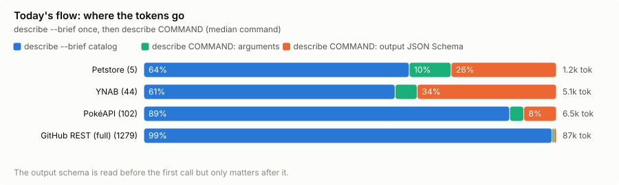
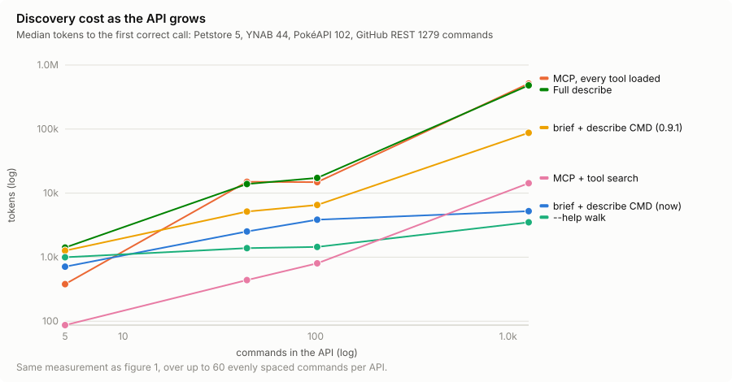
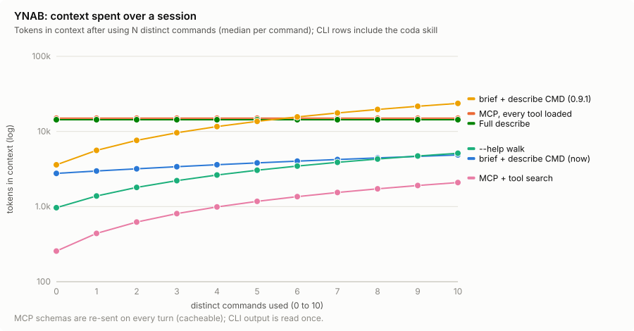

# How efficiently an agent learns a generated CLI

An agent that has never seen an API has to read something before it can make its first
correct call. This report measures how much it reads, and how many tool calls it spends,
for the discovery flow every codapact CLI ships today and for the alternatives an agent
would otherwise use: `--help`, the full `describe`, MCP tool schemas, the raw OpenAPI
document, and llms.txt-style docs.

Everything here is regenerated by two scripts in
[`scripts/discovery_bench/`](../../scripts/discovery_bench/); see [Methodology](#methodology).

Measured on codapact 0.9.1 (`d48fbd0`), 2026-11-16.

## Summary

| | |
| --- | --- |
| **Today's flow** (`describe --brief`, then `describe COMMAND`) | **6.8k tokens, 2 calls** on YNAB. Always enough for a correct first call, including JSON request bodies. 2.6× cheaper than full `describe`, 3.9× cheaper than the OpenAPI document, and below the 15k that MCP puts in context on every turn. |
| **Biggest cost in it** | The output JSON Schema in `describe COMMAND`: 1.7k of its 2.0k tokens on YNAB. The agent needs it only after the call. |
| **Proposed lean flow** | Compact JSON and no output schema until asked: **2.6k tokens** on YNAB (−61%), still 2 calls, still always sufficient. |
| **Where it breaks** | `describe --brief` lists every command, so it grows with the API: **87k tokens** on GitHub REST (1,279 commands). Starting from groups (`--help`, then `describe GROUP --brief`) keeps it at **9.7k**. |
| **Cheapest in tokens** | MCP with client-side tool search (0.6k) and the `--help` walk (1.5k). Tool search needs client support and keeps every tool name resident (14k on GitHub). `--help` costs 3 calls and has no JSON Schemas, so JSON-body commands need `describe COMMAND` anyway. |
| **Worst** | Loading every MCP tool (15k on YNAB, 510k on GitHub, on every turn), the full OpenAPI document (26k, 2.9M), and llms-full.txt (94k, 5.1M). |

## Results

### YNAB: what an agent reads before its first correct call

Six tasks, from "list payees" to "record a 12.34 purchase" (a JSON request body in
milliunits). Each technique is scored on the tokens it returns and the tool calls it takes
until the agent has every fact the task needs. Every reference call passes `--dry-run`.


| Technique | Tokens (median) | Calls | Notes |
| --- | ---: | ---: | --- |
| MCP + tool search | 558 | 1 | plus 256 resident (every tool name), every turn |
| `--help` walk (root, group, command) | 1,530 | 3 | `transactions create`: no body schema, falls back to `describe COMMAND` (7.5k, 4 calls) |
| **Lean describe (proposed)** | **2,645** | **2** | today's flow without the output schema, compact JSON |
| OpenAPI, targeted reads | 2,781 | 6.5 | assumes perfect grep; the agent then writes the HTTP call itself |
| llms.txt, then one page | 4,791 | 2 | same: no execution layer |
| `--help`, `describe GROUP --brief`, `describe COMMAND` | 4,878 | 3 | today's CLI, group-first |
| **`describe --brief`, `describe COMMAND` (today)** | **6,762** | **2** | what the coda skill tells agents to do |
| MCP, every tool loaded | 14,821 | 0 | resident on every turn |
| Full `describe` | 17,973 | 1 | lacks JSON-body schemas: `transactions create` needs `describe COMMAND` too |
| Raw OpenAPI document | 26,273 | 1 | |
| llms-full.txt | 93,710 | 1 | |

Per-task numbers are in [`data/results.json`](data/results.json) under `apis.ynab.tasks`.

### Where today's tokens go

`describe COMMAND` returns the command's arguments and its output JSON Schema. The schema
is the larger part on YNAB and Petstore, and the agent does not need it to make the call.
On large APIs the catalog itself dominates.



### Scaling with API size

Median over up to 60 evenly spaced commands per API: Petstore (5 commands), YNAB (44),
PokéAPI (102), and the full GitHub REST description (1,279).



| API (commands) | brief + describe CMD (today) | group brief + describe CMD | `--help` walk | MCP, every tool | MCP + tool search | Full describe | OpenAPI document |
| --- | ---: | ---: | ---: | ---: | ---: | ---: | ---: |
| Petstore (5) | 1.2k | 1.5k | 1.0k | 0.4k | 0.1k | 2.0k | 0.9k |
| YNAB (44) | 5.1k | 3.3k | 1.4k | 14.8k | 0.4k | 18.0k | 26.3k |
| PokéAPI (102) | 6.5k | 2.3k | 1.4k | 14.8k | 0.8k | 24.0k | 67.9k |
| GitHub REST (1,279) | 87.4k | 9.7k | 3.5k | 510k | 14.3k | 611k | 2.9M |

Anything that loads the whole API at once (full `describe`, every MCP tool, the OpenAPI
document) grows linearly and passes a 200k context window somewhere between 100 and 1,279
commands. Today's brief catalog grows linearly too, at about 70 tokens per command. Only
flows that start from groups stay small.

### A whole session

An agent rarely makes one call. Each new command costs today's flow another
`describe COMMAND`, while MCP pays once up front and then resends the same schemas with
every turn. CLI rows include the coda skill (435 tokens).



On YNAB, today's flow passes the cost of loading every MCP tool at about six distinct
commands, because each `describe COMMAND` carries a 1.7k output schema. The lean flow stays
under 5k for ten commands.

## Pros and cons

| Technique | Pros | Cons |
| --- | --- | --- |
| **`describe --brief` + `describe COMMAND`** (today) | Two calls, always sufficient. Carries `start`, `auth`, `exit_codes` and notes, so the agent learns readiness, credentials, and error handling in the same call. Typed JSON. Works in any agent with a shell. | Output schema doubles or triples `describe COMMAND`. Catalog lists every command, so it does not scale past a few hundred commands. Pretty-printed JSON costs about a third more than compact. |
| `--help` walk | Fewest tokens of the CLI flows. Every CLI user already knows it. Scales well, since each level only lists its children. | Three calls. No JSON Schemas for JSON arguments; the example for `transactions create` omits the required `--transaction`. No auth or exit-code summary unless the agent also reads root help. Text, not JSON. |
| Full `describe` | One call. | Grows linearly (18k on YNAB, 611k on GitHub). Omits JSON argument schemas, so JSON-body commands still need `describe COMMAND`. |
| MCP, every tool loaded | Zero discovery calls. Typed arguments that clients validate. Standard protocol. | All schemas sit in context on every turn, used or not (15k YNAB, 510k GitHub). Needs a running server and client configuration per agent. Clients cap tool counts. Credentials live in the server config. |
| MCP + tool search | Cheapest per call. Only the schemas used are loaded. | Depends on the client (not every MCP client defers tools). Every tool name stays resident (14k on GitHub). Still needs a server process. |
| Raw OpenAPI document | Authoritative; nothing to generate. | Too large past small APIs (2.9M tokens for GitHub). The agent must build URLs, headers, auth, pagination, and error handling itself. No dry run, no validation, no exit codes. |
| OpenAPI, targeted reads | Few tokens when the agent greps well. | 4 to 7 calls following `$ref` chains. The same execution burden as the raw document. Assumes the agent knows how to search YAML or JSON. |
| llms.txt, then one page | Two calls; readable Markdown. | The index grows linearly (53k on GitHub). Docs only: the agent still writes HTTP calls. Has to be generated and hosted. |
| llms-full.txt | One call. | The largest option on every API. |

What tokens do not show: the CLI and MCP flows also give the agent an **execution layer**.
A codapact CLI reads credentials from the keyring or environment, validates arguments
before sending, offers `--dry-run`, maps failures to exit codes with hints, follows
pagination, and trims responses with `--pick` and `--query`. With the OpenAPI or llms.txt
approaches the agent writes that layer itself, on every call, and its first attempts are
where errors happen.

Latency is not a factor: a warm `uvx codapact-ynab` call takes about 0.3 s
(`describe --brief` 0.31 s, `describe transactions create` 0.29 s, `--help` 0.28 s).

## Recommendations

1. **Leave the output schema out of `describe COMMAND` by default.** Print it with
   `--schemas` (which `describe` already accepts) and print compact JSON when stdout is not
   a terminal. On YNAB this takes the first call from 6.8k to 2.6k tokens and a
   ten-command session from 23k to 5k, with the same two calls. The `notes` line already
   tells agents where the output schema is.
2. **Make `describe --brief` start from groups on large CLIs.** Above a few hundred
   commands (or about 10k tokens), list groups with a summary and command count, and have
   `start` say `describe GROUP --brief`. On GitHub REST this cuts the catalog from 87k to
   about 10k tokens for one extra call. The flow already works today when an agent chooses
   it.
3. **Make `--help` sufficient for JSON arguments.** Name the required fields of each JSON
   argument (or point to `describe COMMAND` for the schema), and build examples that
   satisfy `requires_one_of`. Then the cheapest flow needs no fallback.
4. **Do not add an MCP target for efficiency.** It only wins with client-side tool
   search, which is not universal, and loses badly without it. Reasons to add one would be
   clients without a shell, not context cost.

## Methodology

### What is measured

For each API, each command, and each technique, the benchmark records what the agent
must read, in order, before it can make a correct call to that command:

- **Tokens**: the sum of every text the technique returns along the way.
- **Calls**: tool calls the agent makes. MCP tool schemas arrive with the prompt and count
  as 0 calls; they are reported separately as *resident* tokens because the client resends
  them on every turn.
- **Sufficiency**: a correct call needs certain facts. For every command, these are its
  required arguments and the first three required fields of any JSON argument. The YNAB
  tasks add hand-picked facts (for example `milliunits` for money amounts and `current`
  for the current month). A fact counts only if it appears in the part of the text about
  the target command, so a large catalog does not pass by mentioning a field elsewhere.
  Matching ignores case and `-`/`_` separators (`--pet-id` matches `petId`). When a CLI
  technique lacks a fact, the agent falls back to `describe COMMAND`, and that call is
  added. Other techniques have no fallback, and missing facts are recorded.

### Techniques

| Key | What the agent reads |
| --- | --- |
| `brief` | `describe --brief`, then `describe COMMAND` (the flow in the coda skill) |
| `brief_lean` | Proposed: the same, compact JSON, without `output_schema` (simulated from today's output) |
| `group_brief` | `--help`, `describe GROUP --brief`, `describe COMMAND` |
| `full` | `describe` (fallback: `describe COMMAND`) |
| `help` | `--help`, `GROUP --help`, `GROUP COMMAND --help` (fallback: `describe COMMAND`) |
| `mcp` | A `tools/list` result with one tool per command: `name`, `description`, `inputSchema` built from the command's `describe` entry (JSON arguments keep their full schema), and annotations. This is what an OpenAPI-to-MCP bridge publishes. |
| `mcp_search` | Every tool name resident, then one tool definition loaded by search |
| `openapi` | The contract file as committed |
| `openapi_slice` | A path-search hit, `servers` and `securitySchemes`, then the operation plus every component it references, one call per `$ref` level |
| `llms` | An llms.txt index (one line per operation), then that operation's Markdown page with its schemas inline |
| `llms_full` | Every page concatenated |

### APIs

All generated by this checkout of codapact from contracts in the repository, except GitHub:

- Petstore and Library: `examples/`.
- Countries, YNAB, PokéAPI: `tests/fixtures/corpus/`. YNAB uses the settings of the
  published coda (`mikejhill/codapact-ynab`), so the program is `codapact-ynab`.
- GitHub REST (full): `github/rest-api-description@5c36b6f6`
  `descriptions/api.github.com/api.github.com.json` (14 MB), generated with `strict: false`.
  Only with `--github`.

The two GraphQL examples have two commands each; they appear in the data but not in the
scaling figure.

### Tokens

Counted with the Claude tokenizer that shipped in `anthropic==0.34.2` (`tokenizer.json`),
the only Claude tokenizer that runs offline. Current Claude models tokenize differently, so
treat absolute numbers as approximate. Ratios between techniques, which
is what the conclusions rest on, change much less, because every technique is measured with
the same tokenizer on similar text. To recount with a current model, send the same texts to
the token-counting API.

### Limits

- Agents are modeled, not run. The benchmark assumes the agent picks the right command
  from the list and reads nothing it does not need. Real agents sometimes read more, or
  guess and retry; this report does not measure retries.
- Tool-call framing, the agent's own reasoning, and response bodies are not counted.
- MCP tools are serialized as compact JSON. Clients wrap them in their own format, which
  adds a little per tool.
- `openapi_slice` assumes perfect search; it is a lower bound.

### Reproduce

From the repository root:

```sh
uv sync
uv run --with anthropic==0.34.2 --with tokenizers \
  python scripts/discovery_bench/collect.py --github   # about 3 minutes; drop --github for 1
uv run python scripts/discovery_bench/plot.py
```

`collect.py` writes [`data/results.json`](data/results.json): tool versions, every API's
sizes, per-command results for each technique, the YNAB tasks with their reference calls
and `--dry-run` exit codes, and warm `uvx codapact-ynab` latency (skip with
`--no-latency`). `plot.py` redraws the four SVGs in [`figures/`](figures/) from that file
alone. To add a task, append to `YNAB_TASKS` in `collect.py`; to add an API, add it to
`apis()`.
